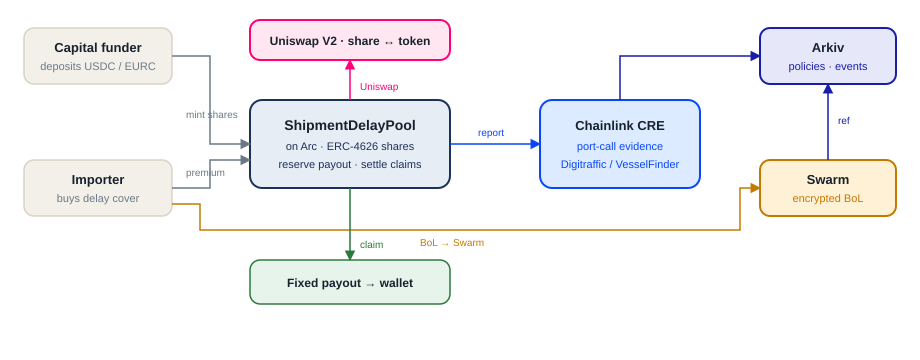

# Skjol

**[Open the live app](https://skjol-insurance.vercel.app)** · [How it’s built](https://skjol-insurance.vercel.app/integrations)

Parametric **arrival delay cover** for small importers: pay a fixed premium in test USDC/EURC; if the named vessel’s recorded arrival at the named port is more than 24 hours after the agreed deadline, a fixed payout is sent to the wallet.

Built for ETHGlobal Mumbai on **Arc** (settlement), **Arkiv** (application DB), **Swarm** (encrypted BoL storage), **Chainlink CRE** (arrival evaluation), **Hedera** (x402 agent payments) and **Uniswap** (pool share trading).

**Arc Studio project:** [studio.arc.io/app/03aa1ed4-…](https://studio.arc.io/app/03aa1ed4-209d-44ee-b09c-2523a48babe3). The USDC pool was tested and deployed in Arc Studio, which also built a pool app on it. Arc bounty: *Best Smart Contracts with Advanced Stablecoin Logic, In Arc Studio*. Details: [`docs/arc-studio.md`](./docs/arc-studio.md).

### Prize tracks and where the evidence is

| Track | Evidence |
|---|---|
| Arc: Best Smart Contracts with Advanced Stablecoin Logic, In Arc Studio | [`docs/arc-studio.md`](./docs/arc-studio.md), [Studio project](https://studio.arc.io/app/03aa1ed4-209d-44ee-b09c-2523a48babe3) |
| Hedera: AI Agents That Pay (x402) | [Hedera x402](#hedera-x402-the-agent-pays-for-port-data) below, [`docs/freight-agent-x402.md`](./docs/freight-agent-x402.md) |
| Arkiv: Build on Arkiv + Arkiv/Swarm bonus | [Arkiv section](#arkiv-writers--one-query-you-can-run) below, [`arkiv/`](./arkiv) |
| Uniswap: Build with Uniswap | [Uniswap section](#uniswap-tradeable-pool-shares) below, [`FEEDBACK.md`](./FEEDBACK.md) |
| Chainlink: Best Workflow with CRE | [`cre/README.md`](./cre/README.md#verified-run-late-arrival-payout-on-arc-testnet): CLI simulation with `--broadcast` that paid out on Arc ([tx](https://explorer.testnet.arc.io/tx/0xc6c0d16e259db9553826f5a7095683b0f858a550d71c48bbf074ef9be07450cc)) |

## How it works

1. **Upload a bill of lading** and confirm the vessel, destination port, and arrival deadline.
2. **Choose cover and pay a fixed premium** in test USDC or EURC. The pool reserves the payout when you buy.
3. **Evaluate the arrival evidence.** If the recorded arrival is more than 24 hours late, the pool sends the fixed payout to your wallet.

Try [Get cover](https://skjol-insurance.vercel.app/cover) with **Use demo wallet (test funds)**. This is a testnet prototype built for ETHGlobal Mumbai. Chainlink CRE currently runs through local simulation with a test forwarder; production DON deployment is pending. See the [CRE workflow notes](./cre/README.md).

## How it’s built



The system diagram from the app’s [How it’s built page](https://skjol-insurance.vercel.app/integrations).

- **Arc:** USDC/EURC pools reserve collateral and settle payouts. Capital funders receive ERC-4626 shares, with share trading through Uniswap V2. The USDC pool ([`0xa750…70c0`](https://explorer.testnet.arc.io/address/0xa7505609b6c380c3f87940db151ef4a5437f70c0)) was deployed from [Arc Studio](https://studio.arc.io/app/03aa1ed4-209d-44ee-b09c-2523a48babe3); its Studio app is in [`arc-studio/`](./arc-studio).
- **Chainlink CRE:** evaluates port-call evidence from Digitraffic or VesselFinder, with labelled replay data for demos.
- **Arkiv:** stores shipment, policy, and event records, including sealed document references.
- **Swarm:** stores AES-256-GCM-encrypted bills of lading; decryption keys stay on the server.
- **Freight agent:** discovers and pays for port data through Arc nanopayments or Hedera x402, and buys cover within configured limits. Available through the [agent UI](https://skjol-insurance.vercel.app/agent) and MCP.

License: [MIT](./LICENSE).

## Arkiv writers + one query you can run

Rabdi testnet · chain id `7794095` · explorer https://rabdi.explorer.arkiv.network

Writer wallets (from `ARKIV_*_PRIVATE_KEY`):

| Role | Address |
|------|---------|
| app | [`0xDc19D52102BEe63eD7eA5cf10B040A1F2B81E75F`](https://rabdi.explorer.arkiv.network/address/0xDc19D52102BEe63eD7eA5cf10B040A1F2B81E75F) |
| observer | [`0x6da9E22E6833605f5a4b45F6F2bCb2362EDEE4Ee`](https://rabdi.explorer.arkiv.network/address/0x6da9E22E6833605f5a4b45F6F2bCb2362EDEE4Ee) |
| sync | [`0x93c3deaEDDb1B2E66082a1445bC0f25fb2487f5B`](https://rabdi.explorer.arkiv.network/address/0x93c3deaEDDb1B2E66082a1445bC0f25fb2487f5B) |

Example shipment entity (encrypted BoL on Swarm, metadata on Arkiv):

- https://rabdi.explorer.arkiv.network/entity/0x44a6479dec093210437f7475cea24b6fe2a8f0f28677801066170658b344a18d
- Swarm ciphertext: https://api.gateway.ethswarm.org/bytes/07c7603b501ecbaa138a31768a2cf4e64ed2d28bcde18f49036b9b094989b0fe

Query that shipment by id (schema `skjol.v1.shipment`, writer = app):

```ts
import { createPublicClient } from "@arkiv-network/sdk";
import { rabdi } from "@arkiv-network/sdk/chains";
import { defineSchema, str } from "@arkiv-network/sdk/schema";
import { eq } from "@arkiv-network/sdk/query";
import { http } from "viem";

const Shipments = defineSchema("skjol.v1.shipment", {
  shipmentId: str().indexed(),
  status: str().indexed(),
  dataLabel: str().indexed(),
});

const client = createPublicClient({
  chain: rabdi({ accessKey: process.env.ARKIV_ACCESS_KEY! }),
  transport: http(),
});

const { entities } = await client
  .select({ $key: true, $expiresAt: true, status: true, dataLabel: true })
  .from(Shipments)
  .createdBy("0xDc19D52102BEe63eD7eA5cf10B040A1F2B81E75F")
  .where(eq("shipmentId", "shp_08a9642d8966468f922e"))
  .fetch();
```

Prize docs: [`arkiv/schema.md`](./arkiv/schema.md), [`arkiv/friction.md`](./arkiv/friction.md), [`arkiv/reach.md`](./arkiv/reach.md), [`arkiv/why-arkiv.md`](./arkiv/why-arkiv.md), [`arkiv/how-you-use-arkiv.md`](./arkiv/how-you-use-arkiv.md), [`arkiv/swarm.md`](./arkiv/swarm.md).

## Swarm (encrypted documents)

BoLs are AES-256-GCM encrypted in the app, uploaded to Swarm `/bytes` (public gateway stamps postage server-side; own Bee uses `SWARM_POSTAGE_BATCH_ID`), then the content reference is sealed inside the Arkiv shipment entity. See [`arkiv/swarm.md`](./arkiv/swarm.md).

Demo checklist:

1. Set `SWARM_MODE=gateway` (or `bee` + postage) — not `local-dev` for judges.
2. Confirm `/integrations` shows Swarm **prize-ready**.
3. `POST /api/swarm/roundtrip` or upload on `/cover` and open the Storage strip links.

## Freight agent (MCP)

`/agent` is a phone agent that finds paid port data, pays each call itself (Arc nanopayments or Hedera USDC via x402), and buys arrival-delay cover inside limits set on the server. Test stablecoins only.

The same tools are an MCP server at `POST /api/mcp`. The client brings the model. Skjol still checks the payee allow-list, the spending limits, and the cover approval before anything is signed.

Sign in on `/agent`, open **Wallet & limits**, and choose **Show MCP token**. The token is the sign-in session and expires with it (12 hours).

```json
{
  "mcpServers": {
    "skjol-freight": {
      "url": "http://localhost:3000/api/mcp",
      "headers": { "Authorization": "Bearer <token from /agent>" }
    }
  }
}
```

Tools: `discoverServices`, `callPaidService`, `listShipments`, `getShipment`, `getQuotes`, `buyCover`, `approveCover`, `getSpendingStatus`. Premiums above the approval threshold (default 0.50) go through `approveCover`, which asks the person in the MCP client before it mints a token for `buyCover`.

Details: [`docs/freight-agent-x402.md`](./docs/freight-agent-x402.md).

## Hedera x402: the agent pays for port data

Skjol's port-data endpoints (`/api/paid/vessel-arrivals`, `/api/paid/delay-risk`) are x402-protected. A 402 response offers two rails: Arc Testnet USDC through Circle Gateway, and **Hedera testnet USDC** (HTS `0.0.429274`), settled by the [x402.org facilitator](https://x402.org/facilitator), which pays the Hedera fee. The freight agent finds the endpoint with `discoverServices` and pays with `callPaidService`. No person approves data calls. Server-side limits apply instead: per-call max, daily cap, payee allow-list and kill switch.

**Payment flow:** agent `GET` → `402 PAYMENT-REQUIRED` → `checkSpend()` on the exact amount → sign a Hedera USDC transfer → retry with `PAYMENT-SIGNATURE` → facilitator verifies → data handler runs → facilitator settles → `200` with `PAYMENT-RESPONSE`. Each decision is written to an HCS audit topic and to the Arkiv spend ledger.

**Settled by the agent on the live app:** [`0.0.9185802@1793886646.362665794`](https://hashscan.io/testnet/transaction/0.0.9185802-1793886646-362665794) on HashScan. 0.01 USDC went from agent `0.0.11322969` to payee `0.0.11322970`. Audit message: [HCS topic `0.0.11322971` #2](https://hashscan.io/testnet/topic/0.0.11322971/message/2).

| Piece | Where |
|---|---|
| Paid endpoints (`withX402`, both rails) | [`lib/x402/server.ts`](./lib/x402/server.ts), [`lib/x402/services.ts`](./lib/x402/services.ts), [`app/api/paid/`](./app/api/paid) |
| Agent payment, limits, rail choice | [`lib/agent-wallet.ts`](./lib/agent-wallet.ts) `payForResource` |
| Hedera signer, HCS audit, HashScan links | [`lib/hedera.ts`](./lib/hedera.ts) |
| One-time testnet setup (accounts, USDC association, topic) | [`scripts/hedera-setup.mts`](./scripts/hedera-setup.mts) |

Reproduce from the command line: `RAIL=hedera BASE=https://skjol-insurance.vercel.app node --env-file=.env.local --import tsx scripts/x402-smoke.mts`. Setup, env vars, architecture and demo script are in [`docs/freight-agent-x402.md`](./docs/freight-agent-x402.md).

## Uniswap: tradeable pool shares

Capital funders get ERC-4626 shares (`skjolUSDC`). Premiums raise their value and payouts lower it. A Uniswap V2 pair against USDC on Arc Testnet lets a funder exit without waiting for capital that is reserved for open policies to free up. Developer feedback: [`FEEDBACK.md`](./FEEDBACK.md).

| Piece | Where |
|---|---|
| Pool share token (ERC-4626) | [`contracts/src/ShipmentDelayPool.sol`](./contracts/src/ShipmentDelayPool.sol) L32, `fund` L215, `maxWithdraw` / `maxRedeem` L239–L252 |
| Create and seed the pair (`createPair`, `addLiquidity`) | [`scripts/seed-share-pair.mts`](./scripts/seed-share-pair.mts) |
| Quote and swap in the app (`getAmountsOut`, `swapExactTokensForTokens`) | [`app/capital/page.tsx`](./app/capital/page.tsx) `TradePanel` L378–L500 |
| Router ABI | [`lib/abi/uniswap-v2.ts`](./lib/abi/uniswap-v2.ts) |
| Factory and router addresses | [`lib/config.ts`](./lib/config.ts) L78–L81 |

On Arc Testnet: pair [`0xE89f…d124`](https://explorer.testnet.arc.io/address/0xE89f57309472a3F26378EC887B738ED294b5d124), V2 factory `0x7483847d46db2920dd64efa676cf72dcf765814f`, router `0xe27d5d256b370604f1ff060fb489c6a8e3f8a6d9`. Try it on [Capital](https://skjol-insurance.vercel.app/capital).

## Develop

```bash
pnpm install
cp .env.example .env.local   # fill secrets
pnpm dev
```

## How we used AI

- **Cursor / Composer** helped implement Swarm postage and Bee tags, the Storage strip UI, and the `/arkiv` prize documentation.
- **Arc Studio's agent** compiled, tested, reviewed and deployed the USDC pool and built the Studio app ([`docs/arc-studio.md`](./docs/arc-studio.md)).
- **Claude Code and Codex** helped with the freight agent, the x402 and Hedera integration, the CRE workflow, the fixes from the pool review and their tests, and the README and track docs.
- **In the product:** the AI SDK (through Vercel AI Gateway) reads bills of lading and runs the freight agent. It never decides a payout. The contract recomputes that from the locked terms.

The team directed the product rules, contracts and Arkiv schemas. AI-written code and text were reviewed before submission.
