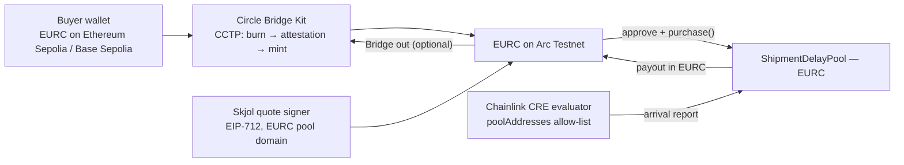

# Euro cover with EURC and Circle Bridge Kit

Track: **Arc: Bridge Kit for Non-USDC Assets**.

Skjol's arrival data covers Finnish ports, so most buyers think in euros. Skjol runs a second pool on Arc Testnet that settles in **EURC**: premiums are paid and payouts are made in EURC. Buyers whose EURC sits on another chain bring it to Arc with **Circle Bridge Kit** (CCTP burn → Circle attestation → mint), and can send a payout back out the same way.

## Pools on Arc Testnet

| Currency | Pool | Token |
|---|---|---|
| USDC | `0x45FFfb2133bAD82eC6eBb140db4F3ce2F651B565` | `0x3600000000000000000000000000000000000000` |
| EURC | [`0x5255301D7cB28F29EE6BACB00c72cbCCC480cb86`](https://explorer.testnet.arc.io/address/0x5255301D7cB28F29EE6BACB00c72cbCCC480cb86) | `0x89B50855Aa3bE2F677cD6303Cec089B5F319D72a` |

The EURC pool is the same `ShipmentDelayPool` contract (it takes its token in the constructor), deployed with `POOL_TOKEN=EURC` ([deploy tx](https://explorer.testnet.arc.io/tx/0x36a7552b0360221c3a898f53b34988e4c4725190d153d37d727a16b568d69398)). Details are in `deployments/arc-testnet-eurc.json`.

## How it fits together

- **Quotes**: `issueQuotes(shipmentId, session, { currency: "EURC" })` signs against the EURC pool's EIP-712 domain. The policy wording names EURC, so its terms hash differs from USDC cover. EURC policies get their own policy id, so a shipment can be covered in either currency.
- **Purchase**: the buyer approves EURC to the EURC pool and calls `purchase()`. The demo wallet does the same server-side.
- **Settlement**: the Chainlink CRE workflow accepts `poolAddresses` and a per-request `pool`, and refuses pools outside the list. The app's sync job mirrors both pools into Arkiv, each with its own cursor.
- **Bridging in and out**: `app/components/bridge-eurc.tsx` loads Bridge Kit in the browser with the connected wallet (`createViemAdapterFromProvider`). The demo wallet uses `POST /api/bridge/demo` (`lib/bridge.ts`, private-key adapter). Each run shows the approve, burn and mint steps with explorer links.

## Where to find it in the app

- `/cover` → after confirming a shipment, switch the quote toggle to **Pay in euros (EURC)**. The buy step shows the **Bridge to Arc** panel.
- `/policies/<id>` → a paid-out EURC policy shows **Move your EURC payout to another chain**.
- `/integrations` lists both pools with balances.
- The Freight Agent can quote and buy EURC cover ("Get EURC quotes for my latest confirmed shipment").

## Setup

1. Get test EURC from [faucet.circle.com](https://faucet.circle.com): Arc Testnet for the deployer (pool capital), and Ethereum Sepolia for the buyer (to bridge). The bridging wallet also needs a little Sepolia ETH for gas.
2. Fund the pool: `POOL_TOKEN=EURC AMOUNT=10000000 node --env-file=.env.local --import tsx scripts/fund-pool.mts` (10 EURC; payouts are reserved against this capital).
3. Try a bridge from the command line: `CHAIN=Ethereum_Sepolia AMOUNT=2 node --env-file=.env.local --import tsx scripts/bridge-eurc.mts`.

Env: `ARC_EURC_POOL_ADDRESS`, `NEXT_PUBLIC_EURC_POOL_ADDRESS`, `ARC_EURC_POOL_DEPLOY_BLOCK` (optional `ARC_EURC_ADDRESS`). Without them, the app shows USDC cover only.
