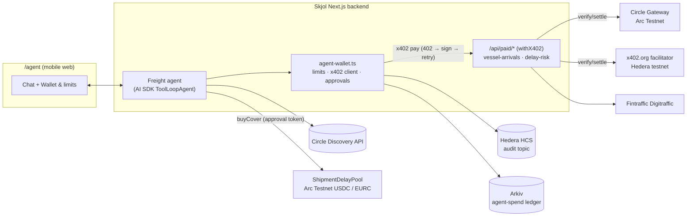
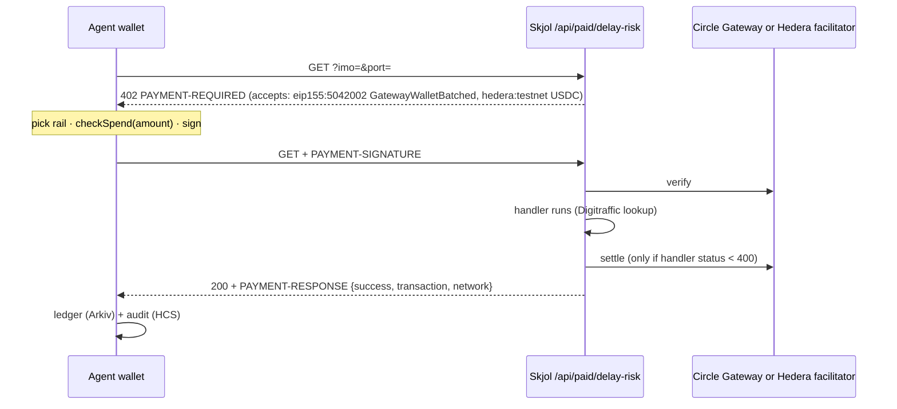

# Skjol Freight Agent and the paid x402 API

Tracks: **Arc: Mobile Consumer Agent (Marketplace Discovery API)** and **Hedera: AI Agents That Pay (x402)**.

Skjol sells parametric cover against a vessel arriving late. The Freight Agent is a phone-sized AI agent (`/agent`) that works for a small importer: it finds paid data services, pays for each call by itself, and buys cover within limits the importer sets. Everything runs on testnets with test stablecoins.

## What it does

1. **Discovers services.** It queries Circle's [Agent Marketplace Discovery API](https://developers.circle.com/agent-stack/agent-marketplace/discovery-api) for services payable on Arc Testnet, and lists Skjol's own paid endpoints from `/api/paid/catalog` (same `ServiceListing` shape).
2. **Pays per call, with no human step.** Each data call answers HTTP 402 with two payment options. The agent picks one and pays:
   - **Arc Testnet USDC via Circle Gateway nanopayments** (gasless, batched settlement), or
   - **Hedera testnet USDC** (HTS token `0.0.429274`), settled by the x402.org facilitator, which pays the Hedera fee.
3. **Buys cover.** It gets signed quotes (USDC or EURC) and calls `purchase()` on the Arc pool from the agent wallet. Premiums above the approval threshold wait for the importer to tap **Approve**.
4. **Keeps a history.** Every decision (paid, declined, failed, cover bought) is written to Arkiv (`skjol.v1.agent-spend`) and to a Hedera Consensus Service topic, and is shown under **Wallet & limits** with links.

## Spending controls (enforced on the server)

All checks run in `lib/agent-wallet.ts` before anything is signed. The prompt never decides whether a payment is allowed.

| Control | Default | Where |
|---|---|---|
| Per data call maximum | 0.05 | `checkSpend()` in `onBeforePaymentCreation`, on the exact amount in the 402 |
| Daily cap (data + cover, rolling 24 h) | 2.00 | `checkSpend()`, summed from the Arkiv ledger |
| Approval threshold for cover | 0.50 | `buyCover` requires an HMAC approval token minted only by `POST /api/freight-agent/approve` (session cookie, human tap), bound to the wallet and quote, valid 10 minutes |
| Kill switch | off | per wallet in the UI, or `AGENT_PAUSED=true` for the whole deployment |
| Hard ceiling | 1.00 per call, 20.00 per day | clamps saved limits; x402 SDK `spendControls` backstop |
| Payee allow-list | — | the agent only pays Skjol's endpoints or resources returned by discovery |

Payments for one wallet are serialised so two parallel tool calls cannot both slip under the daily cap.

## Architecture



### x402 payment flow



## MCP

The same actions are available at `POST /api/mcp` for any MCP client (Cursor, Claude, another agent). The client supplies the model. Skjol still enforces the payee allow-list, spending limits, and the cover approval token before anything is signed.

Sign in on `/agent`, open **Wallet & limits**, and choose **Show MCP token**. Put the bearer token on the client. It is the same HMAC session as the sign-in cookie and expires with it (12 hours). Premiums above the approval threshold use `approveCover`, which asks the person in the MCP client before it mints the token.

## Code map

| Piece | File |
|---|---|
| Seller: resource server, both rails, Bazaar discovery extension | `lib/x402/server.ts` |
| Paid services and Discovery-format catalog | `lib/x402/services.ts`, `app/api/paid/*` |
| Data behind the services | `lib/vessel-data.ts` |
| Buyer: limits, x402 client, Gateway deposit, approvals | `lib/agent-wallet.ts` |
| Agent and tools | `lib/freight-agent.ts`, `lib/freight-ops.ts`, `app/api/freight-agent/*` |
| MCP server (same tools, bearer session) | `lib/freight-mcp.ts`, `app/api/mcp/route.ts` |
| Hedera signer and HCS audit | `lib/hedera.ts` |
| Ledger and settings on Arkiv | `lib/store/arkiv.ts` (`skjol.v1.agent-spend`, `skjol.v1.agent-settings`) |
| Mobile UI | `app/agent/freight-agent.tsx` |
| Tests | `tests/agent-wallet.test.ts` |

## Setup

Arc (already configured with the demo wallet):

```bash
# demo wallet deposits 1 test USDC into Circle Gateway, then pays one call on Arc
RAIL=arc node --env-file=.env.local --import tsx scripts/x402-smoke.mts
```

Hedera:

1. Create a testnet account at [portal.hedera.com](https://portal.hedera.com) and put it in `.env.local` as `HEDERA_OPERATOR_ID` / `HEDERA_OPERATOR_KEY`.
2. `node --env-file=.env.local --import tsx scripts/hedera-setup.mts` creates the agent and payee accounts (ECDSA), associates both with testnet USDC and creates the audit topic. Paste the printed lines into `.env.local`.
3. Send testnet USDC to the agent account from [faucet.circle.com](https://faucet.circle.com) (network: Hedera Testnet).
4. Restart the app, then check: `RAIL=hedera node --env-file=.env.local --import tsx scripts/x402-smoke.mts`.

Once `HEDERA_PAYEE_ACCOUNT_ID` is set, every paid endpoint also offers the Hedera rail, and the agent defaults to it.

| Variable | Purpose |
|---|---|
| `X402_ARC_PAY_TO` | Seller address for Arc nanopayments (defaults to `DEPLOYER_ADDRESS`) |
| `HEDERA_PAYEE_ACCOUNT_ID` | Seller Hedera account; enables the Hedera rail |
| `HEDERA_AGENT_ACCOUNT_ID`, `HEDERA_AGENT_PRIVATE_KEY` | Agent payer account (also submits HCS messages) |
| `HEDERA_AUDIT_TOPIC_ID` | HCS topic for the audit log |
| `HEDERA_FACILITATOR_URL` | Defaults to `https://x402.org/facilitator` (Blocky402 and Launa also work) |
| `PUBLIC_BASE_URL` | Public URL used in resource URLs (defaults to the Vercel production URL) |
| `AGENT_PER_CALL_MAX_UNITS`, `AGENT_DAILY_CAP_UNITS`, `AGENT_APPROVAL_THRESHOLD_UNITS`, `AGENT_PAUSED` | Default limits (6-decimal units) and the global kill switch |

## Settled payments (testnet)

| Rail | Reference | Notes |
|---|---|---|
| Arc Gateway deposit | [`0x50ad3c51…709c`](https://explorer.testnet.arc.io/tx/0x50ad3c51f61e987d3918de631761b7171cac4a37f9dbad1e66e4ba66e530709c) | Demo wallet funds 1 USDC of Gateway balance |
| Arc nanopayment | Gateway transfer `305f2ff8-b2db-4de0-b53c-5e9c66130ffa` | `scripts/x402-smoke.mts`, 0.01 USDC |
| Arc nanopayment | Gateway transfer `a364265a-0801-47d4-b892-5e9a685b24ac` | Paid by the agent from chat, ledger entity on Arkiv |
| Hedera USDC | _add after Hedera setup_ | HashScan link from the agent's receipt |

## Demo script (phone screen, about 3 minutes)

1. `/agent` → **Use demo wallet**. Show the wallet strip: spent today, rail, active.
2. Tap a sample shipment, confirm the details in the review card.
3. "Check the delay risk for my shipments and cover anything risky." The agent searches the marketplace, pays 0.01 per call (receipt chips with network and audit link), then asks for quotes.
4. The Plus premium (1.20) is above the 0.50 threshold → approval card → **Approve** → cover bought, transaction link.
5. **Wallet & limits**: lower the per-call limit to 0.005, ask again → declined with the reason. Hit the kill switch → everything declined.
6. Show the purchase history (Arkiv) and the HCS topic on HashScan.
